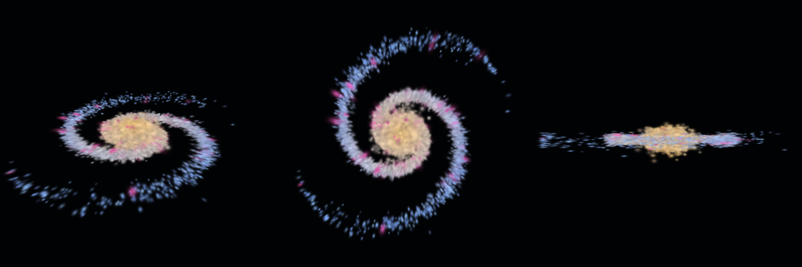

# x3d.nVidia

**Where X3D meets NVIDIA.** The agentic home for everything that connects X3D, the ISO web-3D scene graph, to NVIDIA's stack: NIM models on build.nvidia.com, Omniverse and OpenUSD, Gaussian splats (3DGRUT, gsplat, Lyra), CUDA Python (Warp), world models (Cosmos), plus the open pieces around them: Hugging Face, Objaverse, V-JEPA and DSPy.



*`scenes/splat_galaxy.x3d`: 12,000 procedural Gaussians in an X3D 4.1 `GaussianSplats` node, slowly turned by a TimeSensor → OrientationInterpolator → ROUTE, drawn by X_ITE 16.8.1 (headless Chrome, llvmpipe) from its three Viewpoints. The same cloud ships as `.ply`, `.usda` and `.glb`.*

## Start here
| File | What |
|---|---|
| [`ATLAS.md`](ATLAS.md) | **The map.** Every NVIDIA surface × X3D touchpoint, each marked ✅ measured / 🔎 read / ⏳ not run |
| [`QUESTS.md`](QUESTS.md) | Ranked, claimable projects that make X3D's case on NVIDIA tech |
| [`AGENTS.md`](AGENTS.md) | House rules for every session (evidence, secrets, kits, the shared 40-rpm key) |
| [`docs/handoff-keyed-agent.md`](docs/handoff-keyed-agent.md) | What the session holding the NVIDIA key runs first |

## The founding result: Splat Rosetta (Q0) ✅
One trained 3DGS cloud through **four standards** — `.ply` → **X3D 4.1** `GaussianSplats` / **OpenUSD 26.03** `ParticleField3DGaussianSplat` / **glTF** `KHR_gaussian_splatting` (ratified Sep 2026). Every round trip agrees to float32 rounding. OpenUSD's validators report 0 errors. And **X_ITE draws our native X3D within 1/255 of its own PLY loader**: 91 of 262,144 pixels differ, and the glb → usda → x3d chain gives the same frame. Receipt: `receipts/rosetta-20261126-amethyst-llvmpipe.json`. Contract and caveats: ATLAS §1.

```bash
pip install -e ".[dev]"            # numpy; usd-core>=26.3 for USD
pytest -q                           # 26 tests, offline
x3dnv-splats cloud.ply out.x3d out.usda out.glb --max-splats 20000
x3dnv-probe --out receipts/         # needs NVIDIA_API_KEY (see AGENTS.md)
```

## Layout
```
src/x3dnv/splats.py     PLY ⇄ SplatCloud ⇄ X3D 4.1 / USD 26.03 / glTF KHR (readers + writers + checks)
src/x3dnv/galaxy.py     procedural splat galaxy + an X3D world around it (ships under this repo's licence)
src/x3dnv/nim.py        build.nvidia.com client: stdlib, paced, key never logged (same contract as x3d.lab PR #5)
src/x3dnv/probe.py      catalog / X3D-writing / USD-schema / TRELLIS probe → receipts
src/x3dnv/x3dcheck.py   fast triage score for model-written X3D (x3d_mcp is the real validator)
tools/rosetta_check.py  the Q0 conformance run (convert, validate, X_ITE frames, pixel deltas)
tools/usd_judge.py      runs model-written OpenUSD splat scripts in isolation and grades the file they write (0–7)
tools/xite_render.mjs   X_ITE in headless Chrome (Playwright); --gpu for ANGLE/Vulkan on Colab
notebooks/00_NVIDIA_Probe.ipynb, 01_Splat_Rosetta.ipynb   VERBOSE/VISUAL on; secrets via Colab Secrets
scenes/                 splat_galaxy.{x3d,ply,usda,glb}; trellis_input_rocket.x3d (the TRELLIS test image's source)
receipts/               one JSON per measured run
```

Sibling repos: `hagopjay/x3d.lab` (fidelity flywheel, Foundry, Unreal), `x3d.wgpu` (Rust renderer), `x3d-blender-io`, `x3d.loom`, `x3d.demo`.
